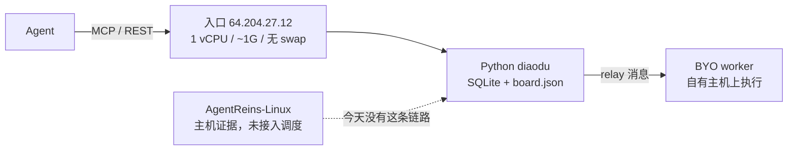
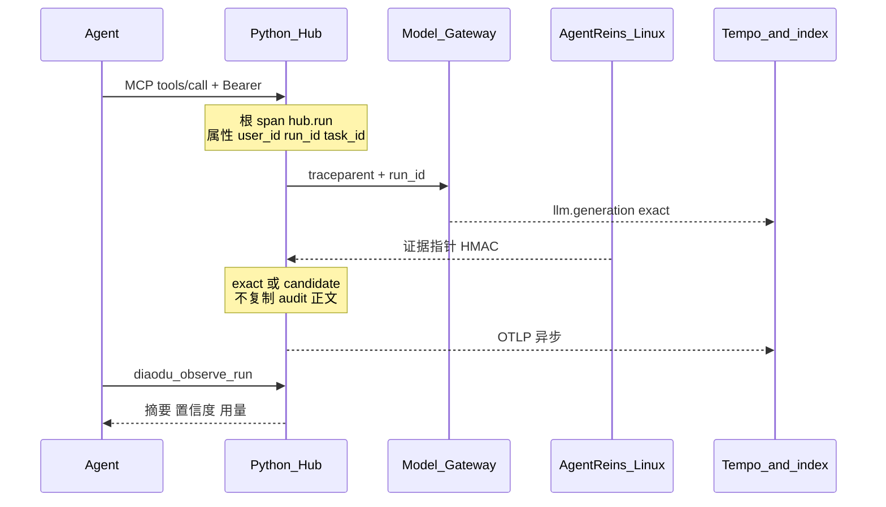
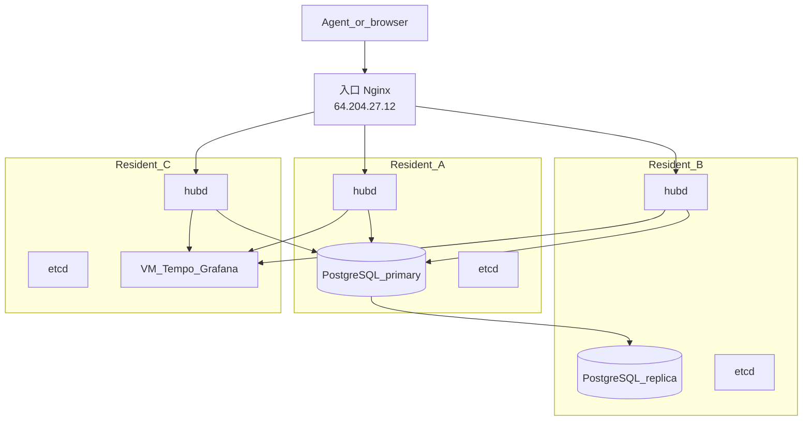
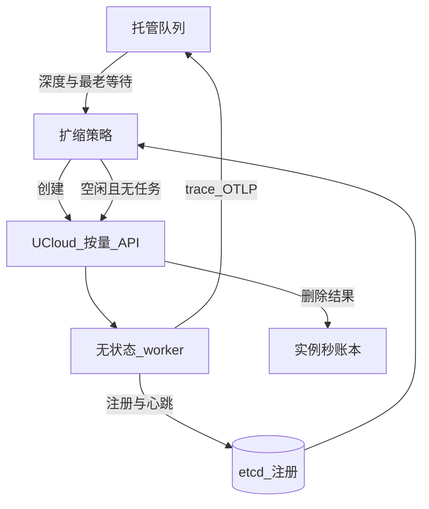

# 云端 Agent Harness 集群规划

状态：待评审的设计，不含实现。本文件不改变 `diaodu` 的运行行为。

基线：已合并的 [PR #20](https://github.com/yardfribley-bit/agentreins-diaodu/pull/20)（持久身份与 MCP 发现）。日期：2026-10-28。

负责人给定的优先级：**先把可观测性做扎实，再扩容**。Phase 1 在现有 Python Hub 上交付，不把 Go 重写当作观测的前置条件。

阅读约定：

| 标记 | 含义 |
|---|---|
| 事实 | 当前仓库、部署说明或 AgentReins-Linux 文档里已经成立 |
| 决定 | 本规划选定的做法，实现 PR 应遵守，除非评审改掉 |
| 估计 | 资源上限或政策初值，**不是**在目标机器上测得的 benchmark |

文中的 IP 来自现有部署事实：当前入口 `64.204.27.12`；常驻机器的规格参照 `43.156.36.182`（2 vCPU、3.7G RAM、59G 磁盘）。该参照机只说明机器等级，不在本文里被指定为某个角色。

## 1. 定位与目标客户

本地 Agent（Claude Code、Codex 及同类产品）容易获得，也容易被复制。护城河在云端 harness：调度、高可用、隔离、可观测性。

AgentReins Hub（本仓库，Python `diaodu`，对外 `https://www.chuhaijian.com/task/`）今天是任务、身份和通信工作台。目标形态是一个用 Golang 写的、可水平扩展 API、有明确领导者与状态存储的 harness 集群。常驻容量是约 3 台 2 vCPU / 4G 的机器；突发任务用 UCloud 按量、无状态的 worker，空闲后释放。

目标客户，按产品成熟顺序：

1. 小型 Agent 产品团队与独立开发者。需要免注册接入、稳定 `user_id` 和可查询的运行记录。
2. 在云端并行跑 Claude Code / Codex 的工程团队。需要队列、并发和按人或按任务的消耗。
3. 在意安全与合规的企业。更晚、单价更高。要求隔离、保留策略和证据链。Phase 1 就要挡住跨用户泄露，企业合同能力后置。
4. 安全测试与运维类长任务（例如 PentAGI）。任务中间会安静很久，不能按 CPU 空闲回收；主机证据沿用 AgentReins-Linux。

主客户是 Agent。人用的页面、Grafana 都是同一份读模型的投影。Agent 通过现有 MCP / REST 读取追踪、用量和告警，不需要打开控制台。

本规划不做的事：不报价、不承诺 QPS、不把团队内部的领导者选举搬进 etcd、不把公开对话页变成命令审计页、不实现 OAuth 2.1（PR #20 已把持久化放在 Bearer token 上）。

## 2. 现状与缺口

### 2.1 已经有的能力（事实）

单进程 Python 服务，systemd 用户 `diaodu`，监听 `127.0.0.1:8765`，Nginx 以 `/task/` 反代。部署说明写明生产是单写入进程。入口机 `64.204.27.12` 为 1 vCPU、约 1G RAM、无 swap，后续只保留为入口。

数据在 `data/library/`：任务板 `board.json`（进程内锁）、`identity.sqlite3`（WAL）、`relay.sqlite3`、`relay_teams.sqlite3`，以及附件目录。备份方式是 SQLite `backup` API，或停机后整目录复制。

身份（PR #20）：

- 匿名接入签发 `user_id`（`us_`）、`agent_id`（`ag_`）和一次性明文 `da_` token，库内只存哈希。
- 未绑定邮箱时 `account_key` 就是 `user_id`。用户同意后，邮箱成为 `account_key`，旧键写入 `identity_aliases`。任务、群聊、操作记录仍挂在原来的 `user_id` 上。
- 邮箱冲突返回 409 `email_in_use`；已绑定另一邮箱返回 409 `email_already_bound`。`email_verified` 仍为 false。
- `ops` 表记录 `connect`、`bind_email`、`unbind_email`、`reconnect`。持有凭证的人用 `GET /v1/me/activity` 读取。这是账户审计，不是运行时 trace。`GET /v1/me` 的 actor 不含邮箱。`account_key` 会在 connect、`/v1/me/profile` 和 `/v1/me/activity` 返回，绑定邮箱后这个键就是邮箱。公开任务不带邮箱。

入口：

- 任务 MCP：`/task/v1/mcp`。设计 MCP 代理：`/task/v1/mcp/design/`，上游 `127.0.0.1:18790`，设计服务令牌只在服务器环境变量。应用等待上游的默认上限 600 秒；Nginx `proxy_read_timeout` 仍是 300 秒。
- MCP 会话在进程内存中（上限 2000、约 24 小时），重启即失。跨重启的身份是 Bearer token。
- 工具覆盖任务、群聊、工作流、邮件、获客、一对一 relay、团队 relay。`diaodu_connect` 之后同一 MCP 会话复用身份。

通信工作台与团队：

- 一对一：mentor / worker 各一席。团队：owner、mentor（seat 0）、同时在席 worker 上限 `MAX_WORKERS_CAP = 8`。门禁 `max_joins` 可扩到 64，同时在席人数仍受席位上限约束。
- 团队领导者是应用层租约（`LEASE_SECONDS = 20`），心跳续约，选举记入协议侧信道，不进入工作流。法定人数按租约窗口内仍出现的 mentor 与 worker 计算。这不是进程级选主。
- 长轮询：一对一与团队各有一个池。默认每库 256、每会话 32（`DIAODU_RELAY_MAX_WAITERS` / `DIAODU_RELAY_SESSION_WAITERS`，硬顶 4096）。`wait=0` 不占名额，单次等待上限 20 秒。

执行：

- 远端 worker 是自己加入 relay 的 Agent，在它自己的主机上执行，把进度和结果发回 Hub。Hub 转发并保存消息，不托管模型，也不对远端命令做沙箱。
- `diaodu/runners.py` 能在本机用进程组拉起 codex / workbuddy / doubao / grok。共享服务上旧 `/api/jobs` 不对外开放（Nginx 不发布 `/task/api/`）。当前线上路径没有 cgroup、磁盘配额或网络策略。

AgentReins-Linux（`github.com/yardfribley-bit/AgentReins-Linux`，站点 `agentreins.info`）是另一套产品，做主机侧证据，尚未进入 Hub 的调度视图。它的架构把证据分成控制、应用、内核、关联四层；采集走 netlink / Docker / inotify / netfilter 与 audit，写入 JSONL；OpenAI 兼容语义网关记录模型请求、响应和工具调用；控制台在服务端建 SQLite 索引。文档明确：模型与命令的关系按命令文本和时间窗口做**候选**关联，不能当成完整的任务级追踪；没采到事件不等于没有访问。控制台默认只监听回环地址，没有内置登录；脱敏不是访问控制。Dify 索引说明（2026-10-19）写的是最近 72 小时、最多 10 万条、1 GiB 软限制、2 GiB SQLite 页上限；通用控制台文档又写历史库没有自动过期。两处保留策略不一致，Hub 不能假定一个统一的保留数字。驾驶舱页面 5 秒轮询。公开站点是产品形态参考，不是客户数据源。

### 2.2 缺口（事实归纳）

- 没有跨 Hub 任务、Agent 会话、worker 进程、工具调用的统一 trace。账户 `ops` 覆盖不了这些。
- 调度视图看不到 AgentReins-Linux 的证据，也没有 exact / candidate / unknown 的置信度。
- 没有按 `user_id`、`agent_id`、任务汇总的 token、计算时间或云主机时长。绕过网关的模型调用今天无法计价。
- 1G 入口机无 swap，放不下指标、日志、trace 的存储。
- 单进程 + SQLite + `board.json` 不能多点写入。长轮询名额是进程内集合，第二台机器无法共享。
- MCP 会话在内存里，入口若有多副本，`Mcp-Session-Id` 会粘在某一台进程上。
- 远端命令没有沙箱和资源上限；本机 runner 也没有。
- 没有中央队列。今天是 Agent 自己来拉取。因此“按队列深度扩容”还没有可观测的队列。
- 团队选举的 20 秒租约和将来的节点心跳是两件不同的事，实现时如果合成一个租约，会让席位领导者跟着机器故障一起抖动。

## 3. Phase 1 — 可观测性

Phase 1 结束时，持有凭证的 Agent 能够回答三件事：这次 run 做了什么、消耗了多少 token 和墙钟时间、主机证据是 exact、candidate 还是 unknown。人看的图从同一份数据投影出来。此阶段不增加写入副本，不引入 UCloud 账单。

### 3.1 部署形状（决定）

| 机器 | Phase 1 角色 |
|---|---|
| `64.204.27.12` | 继续只跑 Nginx + 现有 Python。进程内 OTLP 导出。不在这台机器上跑 Collector 存储或 Grafana |
| 一台常驻机（2 vCPU / 约 3.7–4G / 约 59G） | 唯一的观测后端：Collector、VictoriaMetrics、Tempo、Grafana |
| 另外两台常驻机 | Phase 1 可以还没有。有的话只跑 Collector，不跑第二套存储 |
| 已有的 BYO worker | 可选：安装 AgentReins-Linux，向 Hub 推送证据指针 |

导出失败只增加计数并丢弃批次，请求路径继续返回业务结果。1G 且无 swap 的入口机不能为了遥测阻塞或被撑满。

### 3.2 栈选择与 4G 内存（决定 + 估计）

采用 OpenTelemetry。Python 进程使用 OTLP/HTTP 导出（避免在 1G 入口上再挂 gRPC 客户端）。Collector 用 `memory_limiter`，其 `limit_mib` 低于 cgroup 上限，并留出 `spike_limit_mib`。

观测节点上的后端：

| 组件 | 作用 | 为何留在 4G 方案里 |
|---|---|---|
| OpenTelemetry Collector | 接收、限流、尾部采样、转发 | 有硬内存上限，适合当保险丝 |
| VictoriaMetrics 单进程 | 低基数指标，Prometheus 远程写入与查询 | 单二进制；官方定位是用比同等 Prometheus 更小的内存吃下时间序列。RSS 取决于序列数和保留期，本文不引用未实测数字 |
| Grafana Tempo 单进程模式，本地盘 | 按 trace id 存 span | 短保留时可以单节点。体积由采样和保留期卡住 |
| Grafana | 人看的仪表板 | 停掉不影响 MCP 读路径 |

日志不单开第三套库。日志以 span event 进入 Tempo；原始 JSONL 在观测节点上按大小轮转，只供排障。Agent 读到的是带 `trace_id` 的事件，不是任意日志查询语言。

曾比较、本阶段不采用的形态（决定）：

| 方案 | 结论 | 原因 |
|---|---|---|
| Loki + Mimir + Tempo + Grafana 全套 | 不放上这台 4G | 多套存储加上压缩会抢磁盘延迟，和后续 etcd 共磁盘时风险更高 |
| Elasticsearch | 不采用 | 内存和堆配置超出本阶段机器 |
| Jaeger all-in-one | 不采用 | 上游将其视为演示形态 |
| ClickHouse | 不在 Phase 1 | 适合更大的 trace 量，不适合和入口预算绑在一起 |
| 把 trace 存进入口机 SQLite | 不采用 | 该机约 1G 且无 swap，SQLite 已经承载身份和 relay |
| 只上 Grafana Cloud 一类托管 | 不作为 Phase 1 默认 | 证据和提示词可能出境；若以后单列，必须按客户等级改决定 |

观测节点上的 cgroup 上限是**估计**，用来防止互相撑死。参照机约 3.7 GiB，按 3789 MiB 计算：

| 进程 | cgroup 上限（估计） |
|---|---|
| 系统与页缓存保底 | 800 MiB |
| Collector | 192 MiB（`memory_limiter` 低于此值） |
| VictoriaMetrics | 512 MiB |
| Tempo | 768 MiB |
| Grafana | 256 MiB |
| 合计 | 2528 MiB，剩余约 1.2 GiB 给突发 |

这些数字是规划帽，不是实测 RSS。Phase 1 的退出条件要求把每个进程的峰值 RSS 记下来。任一进程顶满 cgroup，或 `MemAvailable` 低于 512 MiB，就先缩短 Tempo 保留或加严采样，而不是把上限再调高到盖过整机。

磁盘同样用目录配额卡住（估计，参照 59G 盘）：系统 8G、VictoriaMetrics 8G、Tempo 20G、轮转 JSONL 8G。这块盘在 Phase 1 只放遥测。任务附件仍留在现有 `data/library/`。

指标标签禁止 `task_id`、`user_id`、`run_id`、提示词、工具参数。这些只出现在 span 属性里。按人或按任务的用量走单独的汇总表（见 3.5），不走高基数时间序列。

采样（决定）：在采集量小的阶段保留全部业务 span。Collector 的 `memory_limiter` 开始拒绝，或 Tempo 写入延迟升高时，改为尾部采样：错误、`blocked`、选举、带证据指针的 span 保留；其余按比例。空的长轮询超时不产生 span，只记指标 `hub_relay_poll_timeout_total`。一次 20 秒的空等不是延迟故障。

### 3.3 统一事件模型 `ar.observe.v1`（决定）

一条 trace 的根是 `hub.run`（一次 `run_id`）。任务是长期开放的，用属性 `ar.hub.task_id` 和 span link 关联，不把整个任务做成一个跨天的父 span。团队会话用 `ar.team.session_id`，选举是短 trace，链到会话而不是链到某次 run。

W3C `traceparent` 从 Hub 发出。进入的请求若已带 `traceparent`，Hub 延续它。属性名遵循实现 PR 所锁定的 OpenTelemetry GenAI semantic conventions 版本；本文不绑定仍在改名的 token 字段。

资源属性：`service.name` 为 `agentreins-hub`、`agentreins-worker` 或 `agentreins-linux`；`ar.plane` 为 `hub`、`worker` 或 `linux`。

关联键：

| 属性 | 用途 |
|---|---|
| `ar.hub.user_id` | 历史与用量的稳定键。绑定邮箱后也不改 |
| `ar.hub.agent_id` | 实例 |
| `ar.hub.task_id` / `ar.hub.run_id` | 任务与本轮执行。短编号 `T000001` 只做展示，存储仍用内部 id |
| `ar.team.session_id` / `seat` / `term` | 团队席位与任期 |
| `ar.worker.node_id` | BYO 或将来的托管节点 |
| `ar.linux.evidence_id` | 指向主机证据，不内嵌原始 audit |

`account_key` 可能是邮箱，**不**写入 span，**不**出现在观测 API。响应只给 `user_id` 和 `email_bound`。

事件种类：

| 名称 | 何时记录 |
|---|---|
| `hub.run.started` / `hub.run.finished` | 创建 `run_id`，以及报告或明确结束 |
| `hub.mcp.tool` | 每次 `tools/call` 结束 |
| `hub.http` | 写请求。读请求在采样开启前可以只留指标 |
| `hub.relay.message` | relay 消息落库 |
| `hub.relay.wait` | 长轮询返回了事件或错误。纯超时不记 span |
| `hub.team.election` | 参选、投票、就任、租约丢失 |
| `worker.process` | 进程启动与退出码。Phase 1 的 BYO worker 能上报则记，不能则缺省 |
| `worker.tool` | worker 自报的工具调用 |
| `llm.generation` | 语义网关看到的模型往返 |
| `linux.evidence` | 证据指针和置信度，不含原始审计正文 |
| `usage.rollup` | 每小时汇总，供用量 API |

默认不记录提示词和工具参数正文（决定）。span 上保留工具名、状态、`prompt_chars`、`arg_bytes`。某账户打开 `capture_payloads` 后，只捕获该账户自己的 run。公开任务板继续公开任务文字；trace 不跟随公开目录。

置信度沿用 AgentReins 已经公开的诚实标准：

| 值 | 含义 |
|---|---|
| `exact` | 同一 `trace_id`，或网关/进程环境里带了 Hub 签发的 `run_id` |
| `candidate` | 仅有命令文本、时间窗口、PID 一类匹配 |
| `unknown` | 没有证据。展示为未知 |
| `not_applicable` | 这个计量本阶段不存在，例如 Phase 1 的 UCloud 机时 |

候选关联保持为候选。观测 API 和页面都展示这个词。

### 3.4 接入 AgentReins-Linux（决定）

Hub 不抓取 `agentreins.info` 的公开页面或公开只读 API 来充当客户数据。该站点没有内置登录，命令和工具输出可能在页面上，脱敏不能代替授权。

集成方向是 **worker 侧推送**：

1. Hub 在发往该 worker 的调度或 relay 上下文里放入 `traceparent` 与 `ar.hub.run_id`。托管进程将来把它们放进环境变量；Phase 1 的 BYO worker 由接入说明要求其转发到语义网关请求头（建议头 `X-AR-Run-Id`，与 `traceparent` 并列）。
2. 主机上的 AgentReins-Linux 仍按它自己的流水线采集。一个小转发器把红acted 指针推给 Hub：`evidence_id`、时间、可执行文件名、退出码、目的地类别（`public` / `private` / `unknown`）、置信度、`run_id`。用每节点密钥做 HMAC。
3. Hub 的 trace 索引只存指针。原始 JSONL 与 SQLite 证据留在主机。观测 API 默认返回摘要。完整命令行要另一次调用，并且调用者是该 run 的 Agent、被授权的任务发布者，或平台运维。
4. 模型与命令若只有时间窗口匹配，转发器必须标 `candidate`。Hub 不升级置信度。
5. Dify / PentAGI 驾驶舱继续留在 AgentReins-Linux。Hub 调度视图链到同一次 run，Phase 1 不重做那套五段驾驶舱。
6. 保留期以各主机自己的配置为准。Hub 索引保留 72 小时作为与 Dify 索引说明对齐的**产品初值**（估计，可改），并在 API 里返回 `retained_until`。不假设通用控制台也是 72 小时。

主机采集器心跳进入指标 `ar_linux_collector_last_seen`。某个声称开启追踪的 worker 心跳消失，产生告警。采集器沉默不等于主机上没有发生事件；告警文案按这个事实写。

### 3.5 成本（决定）

Phase 1 的成本是用量，不是人民币。没有运营者提供的价格表时，API 不返回金额。缺计费点时数值为 `unknown`，不用 0 填充。

| 计量 | Phase 1 来源 | 置信度 |
|---|---|---|
| 输入 / 输出 token | 语义网关的 GenAI 属性，且请求带了 `traceparent` 或 `X-AR-Run-Id` | `exact`；绕过网关则为 `unknown` |
| 墙钟秒 | Hub 上 run 开始到终态报告或 ack | `wall_clock` |
| CPU 秒 | Phase 3 的 cgroup | Phase 1 为 `not_applicable` |
| UCloud 实例秒 | Phase 4 账本 | Phase 1 为 `not_applicable` |

汇总表按 `user_id`、`agent_id`、`task_id`、小时相加。绑定邮箱不改变 `user_id`，历史用量不用重算。价格表若存在，也只在读的时候乘上去，原始 token 保留。

### 3.6 仪表板与告警（决定）

Grafana 只读 VictoriaMetrics 与 Tempo。Agent 不拿 Grafana 账号，也不对 Agent 开放原始 PromQL / TraceQL。

四块板：

1. **Hub 健康**：进程是否在、RSS、5xx、SQLite 文件大小、两个长轮询池的占用（一对一与团队分开）。
2. **协作**：run 开始/结束、报告状态、选举任期变化、长轮询拒绝次数。
3. **单次 run**：按 `run_id` 看 span，证据指针带置信度。这是人使用的投影，字段与 MCP 相同。
4. **用量**：汇总表按天展示 token 与墙钟。未知占一列，不并进 0。

告警先少做，每一条都要能在演练里触发：

| 告警 | 条件 |
|---|---|
| Hub 进程消失 | 入口探针失败 |
| 长轮询接近顶 | 任一库占用超过其上限的 80%，或单会话达到 32 |
| 入口磁盘 | `data/library` 所在卷剩余空间低于运营阈值 |
| 遥测被拒 | Collector `memory_limiter` 拒绝 span |
| 选举抖动 | 单会话任期在一小时内更换次数超过阈值（阈值在有基线后填写，不在本文写死） |
| 证据采集器沉默 | 已登记的 worker 超过心跳窗口仍无 `ar_linux_collector_last_seen` |
| 入口内存 | Python RSS 相对 Phase 1 启动基线的增量超过演练前写下的预算 |

长轮询耗时不进入告警。设计 MCP 被 Nginx 300 秒切断是已知部署缺口，Phase 1 给它一个计数器，调 Nginx 仍由协调人单独做，不塞进本阶段代码。

### 3.7 Agent 与人如何读（决定）

新增工具，旧客户端忽略即可。名字与现有 `diaodu_` 前缀一致：

| MCP | REST | 内容 |
|---|---|---|
| `diaodu_observe_run` | `GET /v1/tasks/{task}/runs/{run_id}/trace` | 该 run 的 span 摘要、证据指针、置信度、token 与墙钟 |
| `diaodu_observe_task` | `GET /v1/tasks/{task}/trace` | 该任务下调用者可见的 run 列表 |
| `diaodu_observe_usage` | `GET /v1/me/usage` | 当前 `user_id` 的汇总 |
| `diaodu_observe_alerts` | `GET /v1/observe/alerts` | 与调用者有关的告警，不含其他租户 |

认证与现有写接口相同：`Authorization: Bearer <da_ token>`，或浏览器 Cookie 加 CSRF。观测接口是普通请求，不占用长轮询名额。

可见性：

- 调度摘要（工具名、时间、状态、token 计数、墙钟）：该 run 的 Agent、任务发布者、平台运维。
- 命令行、路径、网络终点：该 worker 的凭证与平台运维。任务发布者默认看到可执行文件名、退出码和目的地类别。团队 owner 打开 `evidence_share` 后，发布者才能读到已保存的摘要以上的内容。
- 公开目录、公开围观、`/v1/me` 都不附加 trace。
- 跨 `user_id` 读取返回与“资源不存在”相同的对外形状，避免用状态码枚举别人的 `run_id`。实现 PR 选定具体状态码并写进测试。

页面（任务详情上的一条“运行记录”）只渲染上述 JSON。Phase 1 可以没有新页面；有页面也是投影。

### 3.8 Phase 1 内部顺序

1. 在 Python 上导出 OTLP，观测节点起来，健康板和四条基础设施告警可演练。此时还没有 AgentReins 关联。
2. `traceparent` / `run_id` 传播，指针推送，置信度入库。
3. 四条 MCP/REST、用量汇总、跨用户测试、入口机 RSS 对比。

每一步都可以单独上线。第 1 步若把 1G 机器的 RSS 增量推过演练预算，就减小批大小或降采样，不把 Collector 搬上入口机。

### 3.9 Phase 1 退出标准

- 任选一次带终态的 run，Agent 用 MCP 读到工具序列、墙钟，以及 token 的 `exact` 或 `unknown`。
- 同一次 run 若有主机证据，响应里的置信度与转发器一致；只有时间窗口匹配时为 `candidate`。
- 另一 `user_id` 的凭证读不到该 run 的 trace 和用量。
- 公开对话 API 的响应体不含 trace 字段。
- 入口机在观测开启后连续运行，无 OOM；记录 Python RSS 基线与增量。
- 观测节点 `MemAvailable` 在浸泡期间保持不低于 512 MiB；各进程峰值 RSS 写入运维笔记。
- 演练触发：进程探针失败、长轮询顶格、Collector 拒绝 span。告警到达已配置的通道。
- 导出器故障注入时，`POST /v1/tasks` 与 `tools/call` 仍成功。

## 4. Phase 2 — 三台常驻节点上的 Go 控制面

依赖：Phase 1 的事件模型已经有真实 span。Go 进程继续向同一 OTLP 端点导出，属性名不变。

### 4.1 两种领导者（决定）

| 领导者 | 选举什么 | 存放 |
|---|---|---|
| 团队席位领导者 | 哪个 mentor/worker 在本会话里派活 | 继续用现有租约与协议表，`LEASE_SECONDS = 20` |
| 调度器领导者 | 哪一个 `hubd` 跑后台对账、汇总、将来的扩容 | etcd lease |

API 三台都服务。只有后台循环跟 etcd 选主。不把团队选举改写成 etcd，也不为控制面再嵌一套 Raft 库。

### 4.2 状态放哪（决定）

| 存储 | 放入 | 不放入 |
|---|---|---|
| etcd | 成员、调度器租约、worker 注册、长轮询准入计数、小体积 MCP 会话、队列头指针 | 聊天正文、40 万字报告、附件、trace 正文 |
| PostgreSQL | 用户 / agent / run / ops / 别名、任务与条目、群聊、relay 与团队事件、用量汇总、trace 索引（id 与指针） | 100MB 附件字节 |
| 磁盘文件 | 附件与现有 relay 文件 | 身份库 |

SQLite 继续当唯一业务库会把 Phase 2 留在单写入器上，和多节点目标相反。只把业务放进 etcd 则会碰到默认请求大小（约 1.5MiB）和“值应该小”的使用方式；团队报告上限是 40 万字符，附件元数据还会继续涨。Cockroach、TiDB、Yugabyte 一类分布式 SQL 是以后更大集群的选项，内存形态不适合本阶段每台 4G。因此 Phase 2 是一台 PostgreSQL 主库加一台流复制副本，接受主库是写入瓶颈，并用一次真实切换演练记录 RPO/RTO。

身份与任务变更使用同步提交到副本。relay 高流量事件可以在实现 PR 里论证异步提交，但默认与身份同一策略，直到演练证明延迟不可接受。

PostgreSQL 在共驻节点上的起点（估计，供第一次配置）：`shared_buffers = 256MB`，连接池约 20，cgroup 1024 MiB。etcd 的官方硬件说明面向更大的集群；我们的键空间是元数据规模。etcd cgroup 先设 384 MiB，`--quota-backend-bytes` 限制磁盘库。浸泡后若 RSS 顶满，先查是不是把大值写进了 etcd。

### 4.3 三台机器怎么摆（决定）

参照机约 3.7 GiB。角色分开，避免每台都跑齐数据库和 Tempo。

| 节点 | 进程 | cgroup 合计量级（估计） |
|---|---|---|
| A | etcd 384 + `hubd` 512 + PostgreSQL 1024 + 系统保底 700 | 约 2620 MiB，余量给页缓存和附件突发 |
| B | etcd 384 + `hubd` 512 + PostgreSQL 副本 1024 + 系统保底 700 | 与 A 同级 |
| C | etcd 384 + `hubd` 384 + Phase 1 的 Collector 160 + VictoriaMetrics 384 + Tempo 640 + Grafana 192 + 系统保底 700 | 约 2844 MiB。余量小于 A/B。Tempo 先于其他组件被缩短保留 |

节点 C 不跑 PostgreSQL。节点 A/B 不跑 Tempo。入口机在切换完成后只留 Nginx，Python 进程退出。

磁盘（估计，59G 等级）：A 上 PostgreSQL 目录帽 20G、附件 20G、etcd 4G、系统 8G。附件涨破帽子是告警，不是静默失败。C 上的遥测配额沿用 Phase 1。

长轮询不能靠进程内 `Condition` 跨节点。等待方登记在本机，准入计数在 etcd，唤醒用 PostgreSQL `LISTEN/NOTIFY` 或 etcd watch。默认上限仍是每库 256、每会话 32。调高必须在多节点演练之后，避免一张图上的等待者把三台机器的连接打满。

MCP 会话从内存搬到 etcd（体积设上限，超过则拒绝，保持今天 2000 这个量级直到实测）。这样 Agent 不必会话粘滞。PR #20 记录的行为——初始化之后缺失或错误的 `Mcp-Session-Id` 仍被接受——Phase 2 保持，收紧单独立项，避免未通知就打断现有客户端。

### 4.4 API 兼容（决定）

现有 Agent 不改 MCP 地址、不换工具名、不换 Bearer。切换期间入口 Nginx 仍是 `https://www.chuhaijian.com/task/`。

必须保持的契约：

- 路径前缀 `/task/v1`，含 `/v1/mcp` 与 `/v1/mcp/design/`。
- `da_` Bearer、浏览器 Cookie 与 CSRF。
- 工具名、必填参数、破坏性工具上的 `destructiveHint`。
- 身份语义：一次性返回 token、`user_id` 稳定、邮箱 409 代码、`GET /v1/me/activity`。
- 公开发现文件（`/llms.txt`、`/.well-known/mcp.json`）里的 URL 不变。
- 设计代理的鉴权方式不变：Hub 凭证进入，设计服务令牌留在服务器。
- 团队与一对一的路由、长轮询 `wait`、选举侧信道不进工作流。

契约测试是当时 `main` 上的 `tests/` 黑盒用例打到 Go 或打到仍在代理后面的 Python。PR #20 合并时该套件为 262 项；条数会变，以执行迁移时的 `main` 为准。

迁移是快照切换，不是两种语言同时写同一行：

1. 盘点 `identity.sqlite3`、两份 relay 库和 `board.json` 的行数与 id。
2. 用现有 SQLite backup 做一致性快照。
3. 导入 PostgreSQL，保留 `us_`、`ag_`、token 哈希、`tk_`、`T` 短编号、`run_`、`C-p` / `C-t`。
4. 只读对比：行数、哈希抽样、同一组 GET 在两边的 JSON。
5. 短暂停写（今天本来就只有一个写入进程），切换配置。
6. SQLite 快照保留到回滚窗口结束。回滚是 Nginx 指回 Python 并恢复该快照。
7. 附件先留在磁盘。Phase 2 用定期校验的复制把文件放到节点 B，RPO 是复制间隔，在退出记录里写实际间隔。不把 100MB 文件塞进 PostgreSQL。

Phase 2 同时落下一个**尚未驱动扩容**的持久队列，只服务将来的托管 worker。BYO relay 仍是拉取模式。队列深度从此有指标，默认应接近 0。

### 4.5 Phase 2 退出标准

- 三成员 etcd 健康；杀掉调度器领导者后，另一个 `hubd` 在租约到期后接手后台循环，API 在其余节点上持续可写。
- 主库切换演练完成，笔记里有这次演练的 RPO 与 RTO（记录结果，不在本文预写秒数）。
- 导入后的用户、任务、relay 事件行数与快照一致；抽查的 `da_` 哈希仍能通过鉴权。
- 一份不修改配置的现有 Agent（MCP URL + Bearer）完成：连接、读任务、报告、团队读与心跳。
- 团队席位领导者的 20 秒租约在节点故障时不因为 etcd 选主而额外换届。
- 入口机不再运行 Python；指回 Python 的回滚在演练中走过一次。
- OTLP 仍到达节点 C，Phase 1 的 `diaodu_observe_run` 对迁移后的新 run 有效。

## 5. Phase 3 — Worker 运行时与隔离

依赖：Phase 2 的 `hubd`、队列和 trace 索引。本阶段给**托管** worker 加隔离。BYO relay 仍在客户自己的机器上执行，Hub 不能假装已经沙箱了它；观测里 `ar.worker.mode=byo|hosted`。

隔离有两层（决定）：

| 层 | 挡住什么 | 用于 |
|---|---|---|
| 云主机 | 租户之间的内核与磁盘 | 客户 3、客户 4，以及任何要求独占的任务 |
| cgroup v2 + 容器（user namespace、seccomp、丢掉能力、只读根、`no-new-privs`） | 同一台托管机上的任务之间 | 客户 1 和 2 的打包任务 |

gVisor 一类更厚的沙箱留到独占虚拟机仍不能满足客户 3 的威胁模型时再开，不作为 Phase 3 的默认运行时。常驻 4G 节点优先把 CPU 留给控制面；打包任务放在托管 worker 上，而不是放在节点 A 的 PostgreSQL 旁边。

策略初值（估计，实现时做成配置，不是容量承诺）：单任务内存 1 GiB、CPU 配额 1.0、PID 上限 256。一台 4G 等级的托管机上同时两份这样的任务之后，余量留给系统和采集器。超出内存是 span 事件 `worker.oom`，然后按清理流程收场。

镜像预先构建：常驻节点保存 OCI 镜像或 UCloud 自定义镜像说明，里面有 worker 代理、CA、该等级需要的 CLI。镜像不含 `da_` token，不含 Hub 数据库。启动时长在 Phase 4 演练测量。

清理，任何终态都走：

1. 向进程组发 SIGTERM，超时后 SIGKILL（与今天 `runners.py` 的进程组停止同一意图）。
2. cgroup 确认没有残留 PID。
3. 擦除工作目录和启动时注入的引导密钥。
4. 从 etcd 注销该任务占用。
5. span 写下 `cleanup=ok|dirty`。
6. `dirty` 的节点被 cordon，在人工或自动重装之前不接新任务。

网络默认拒绝出站，只允许 Hub 与模型网关。PentAGI 一类任务使用单独的放行策略，并在 AgentReins-Linux 里留下出口证据。放行是任务属性，不是镜像里的永久开口。

### Phase 3 退出标准

- 一个会持续分配内存的托管任务在到达配置上限后被终止，`worker.oom` 出现在 `diaodu_observe_run`，同机另一任务仍在。
- 终态之后工作目录不存在，引导密钥不在磁盘上，etcd 无该任务占用。
- `dirty` 注入（清理脚本失败）后，该节点不再领取新任务。
- BYO 会话的观测响应标明 `mode=byo`，并且不显示 cgroup 限额。

## 6. Phase 4 — UCloud 上的弹性

依赖：Phase 2 队列有真实深度，Phase 3 镜像能启动并完成清理。只扩托管 worker。BYO 会话不触发创建或删除云主机。

UCloud 具体产品名、可用区、镜像 ID、账号配额和计费粒度（分钟或小时）在写适配器之前向当前 API 核对。本文只要求适配器具备：创建按量云主机、查询状态、删除、用实例 id 对账。不在这里写死 URL 或价格。

Worker 无状态（决定）。云初始化只注入一次性引导密钥。进程向 `hubd` 注册，拿到短期节点凭证，在 etcd 写入容量与心跳。磁盘是临时工作区。删除实例之后 Hub 状态仍完整。

扩容信号来自队列，不来自 CPU 利用率。CPU 低可能是 PentAGI 在等下一步，也可能是真的空闲。

| 动作 | 条件 |
|---|---|
| 扩容 | 在持续窗口内，可运行的托管任务队列深度 ≥ 配置 N，且最老等待时间 ≥ 配置 T。N 和 T 用 Phase 1/2 记下的真实等待来填，本文不给秒数 |
| 缩容 | 该实例没有运行中的任务，空闲时间 ≥ 配置 I，并且距上次扩容已过冷却。I 至少数倍于节点心跳租约 |
| 拒绝 | 账号或全局的实例秒、或 token 汇总达到帽子。常驻三节点继续服务。MCP/REST 返回明确错误 |

心跳租约与团队 20 秒租约分开。规划初值：节点租约 30 秒，连续错过 3 次标为 suspect。这是实现前的初值，演练可以改。

全局与单账号的突发台数帽是配置。第一次演练从**一位数的全局上限**起步，记下队列等待后再改。本文不规定最终台数。

失败时任务留在队列里，靠已有的 `request_id` 去重：

| 情况 | 行为 |
|---|---|
| 创建 API 失败 | 退避并告警，不丢任务 |
| 实例已创建但超时未注册 | 超过启动宽限后删除，避免孤儿账单 |
| 同一实例 id 再次注册 | 幂等更新 |
| 心跳丢失且仍有任务 | 租约到期后任务可重试；确认无进程再删除实例 |
| 缩容时发现任务 | 只 cordon，不删除 |
| 删除 API 失败 | 重试；账本状态为“已请求删除”；对账作业按云侧清单纠偏 |
| 达到成本帽 | 不再调度新的突发实例；已在跑的任务跑完 |

账本字段：实例 id、`user_id`、起止时间、状态。金额仍只在有价格表时出现。对账按云侧计费粒度对齐，粒度在接入 API 后写入退出记录。

### Phase 4 退出标准

- 演练把队列压过 N 与 T，观察到实例创建、注册、领任务、上报 trace、进入账本。
- 任务结束后，空闲超过 I，实例被删除；etcd 与工作目录约定均为空（实例已不存在）。
- 创建 API 失败时任务仍可在常驻容量上被 BYO 或剩余托管节点处理，或继续排队且错误可见。
- 成本帽触发后新的突发调度被拒绝，常驻 API 仍可 `diaodu_observe_usage`。
- 一个安静但未结束的长任务（无 CPU、有未完成状态）不会被缩容删掉。
- 账本上的实例秒与云侧清单在一个计费粒度内对上，差异写入演练笔记。

## 7. 容量与资源预算

没有在这些机器上跑过压力测试。下表只有三类数字：已经生效的产品上限（事实）、为了不 OOM 先写上的 cgroup（估计）、第一次演练用的政策初值（估计）。吞吐、QPS、每秒 span 数都不列。

### 7.1 已经生效的上限（事实）

| 项 | 值 |
|---|---|
| 入口机 | 1 vCPU，约 1G RAM，无 swap |
| 常驻机等级 | 约 2 vCPU，参照机 3.7G RAM、59G 磁盘 |
| 团队同时在席 worker | 8 |
| 长轮询 | 每库 256、每会话 32；一对一与团队分池；环境变量硬顶 4096 |
| MCP 内存会话 | 2000 |
| 单附件 / 单次报告附件数 / JSON | 100MB / 20 / 1.2MB |
| 团队最终报告 | 40 万字符 |
| 团队领导者租约 | 20 秒 |
| AgentReins-Linux Dify 索引说明 | 72 小时、10 万条、1 GiB 软限制、2 GiB 页上限。通用控制台文档没有自动过期 |

### 7.2 分阶段预算（估计，除非标明事实）

| 阶段 | 计算放在哪 | 内存与磁盘 | 业务容量 |
|---|---|---|---|
| 1 | 入口仍是单进程 Python（事实）。观测存储在一台常驻机 | 入口：只增加 OTLP 导出，RSS 增量用退出标准去量。观测机 cgroup 见 3.2，遥测磁盘帽 8+20+8G | 产品上限保持第 7.1 节。不提高长轮询名额 |
| 2 | 三台 `hubd` 读多写一（PostgreSQL 主库） | 节点预算见 4.3。入口机切完后只跑 Nginx | 长轮询默认仍是 256/32。队列存在但只为托管任务预留，深度应接近 0 |
| 3 | 托管任务在 worker 上，不在节点 A 上 | 单任务 1 GiB / 1 CPU / 256 PID 为政策初值 | BYO 路径的产品上限不变。托管打包密度由 cgroup 初值推出：4G 等级机器上同时两份 1 GiB 任务后把余量留给系统 |
| 4 | 突发实例无 Hub 状态 | 实例规格从同一 2 vCPU / 4G 等级起步，演练后按任务画像改 | 全局突发台数为一位数政策初值。机时与 token 帽上线前就要有配置，具体数字由运营在演练笔记里填 |

入口机在 Phase 1 的风险最大：无 swap，观测 SDK 与现有 SQLite 抢同一 1G。退出标准把“测到的 RSS 增量”当成门，而不是把上表当成已经测过。

常驻机 3.7G 与“4G 规格”之间差约 300 MiB。预算按 3.7 GiB 写。若实际机器内存更小，先减 Tempo 保留，再考虑加内存。

## 8. 风险、未决问题、里程碑

### 8.1 风险

| 风险 | 缓解 |
|---|---|
| trace 比公开任务板敏感。公开目录今天会展示定向指令正文 | 观测默认不公开；命令与路径另行授权。公开 API 回归测试禁止出现 trace 字段 |
| 1G 无 swap，或 3.7G 上 cgroup 合计仍 OOM | 导出不阻塞；`memory_limiter`；浸泡门限 512 MiB `MemAvailable`；先砍保留和采样 |
| etcd 与 PostgreSQL、或 etcd 与 Tempo 抢同一块磁盘的延迟 | 角色分开；遥测只在节点 C；etcd 值保持小 |
| 候选证据被展示成事实 | API 强制置信度；测试覆盖“只有时间窗口”的样本 |
| 把团队租约和调度器租约做成一个 | 第 4.1 节的分表；故障演练检查团队任期不随节点切换而增加 |
| 多副本之后 MCP 会话仍在某一进程内存 | Phase 2 会话进 etcd；切换前保持单 Python 写入器 |
| 绕过网关的模型调用被记成 0 token | 缺数据为 `unknown`；用量 UI 单独一列 |
| 按 CPU 空闲删除 PentAGI | 缩容只看“没有运行中的任务” |
| 邮箱成为 `account_key` 后被写进 span | 禁止写入；API 只返回 `email_bound` |
| AgentReins 两套保留说明不一致，Hub 展示过期指针 | 响应带 `retained_until`；指针 404 时置信度改为 `unknown` |
| 设计 MCP 的 600 秒应用超时与 Nginx 300 秒 | 计数器可见；改 Nginx 不纳入功能 PR |
| 快照迁移窗口丢写 | 单写入器短暂停写；SQLite 快照可回滚 |
| 突发实例删除失败仍在计费 | 账本状态“已请求删除”+ 对账作业 |

### 8.2 未决问题

1. 语义网关与 AgentReins 转发器部署在每台 worker 上，还是集中一组？Phase 1 可以先做一台试验 worker。
2. 现有 BYO Agent 是否愿意改配置以转发 `traceparent`？不愿意时，该 run 的主机证据保持 `unknown` 或仅 `candidate`。
3. 运营价格表由谁维护，币种是什么？在有表之前不做金额。
4. UCloud 账号的按量配额、地域和计费粒度是多少？
5. 客户 3 是否要求任务板私有化？今天的默认是公开对话。这会改变产品默认值，需要单独决定。
6. 附件复制的 RPO 间隔多长可以接受？
7. `capture_payloads` 的默认关闭是否对客户 4 的取证不够？若不够，只对标明取证的任务打开，并单独规定保留期。
8. 观测 API 对“别人的 run”对外使用 404 还是 403？选定后写入契约测试。
9. Phase 2 的 relay 大流量是否必须同步提交？默认同步，等演练数据再改。

### 8.3 里程碑

| 阶段 | 完成时能说的话 | 退出标准所在 |
|---|---|---|
| 本文 | 评审者能按节批注决定项 | 评审通过前不写生产代码 |
| Phase 1 | 不登录主机也能回答一次 run 的行为、用量和证据置信度 | 第 3.9 节 |
| Phase 2 | 坏掉一台常驻节点后 API 仍在，身份与任务在 PostgreSQL 中，旧 Agent 不改配置 | 第 4.5 节 |
| Phase 3 | 托管任务逃不出 cgroup，结束后磁盘与注册信息都干净 | 第 5 节末 |
| Phase 4 | 队列能拉起无状态 UCloud worker，空闲释放，长任务不被误删，账本可对账 | 第 6 节末 |

建议的实现顺序就是表中的顺序。Phase 1 的 schema `ar.observe.v1` 是后面各阶段的合同；Go 重写、沙箱和扩容都往这份合同上导出，而不是各自记日志。

### 8.4 决定索引

| ID | 决定 |
|---|---|
| D1 | Phase 1 做在现有 Python 和一台观测常驻机上 |
| D2 | Agent 用 MCP/REST 读；Grafana 是投影 |
| D3 | trace 的根是 `hub.run` |
| D4 | 用量键是 `user_id`；`account_key` 不进观测 |
| D5 | 空长轮询只记指标 |
| D6 | 默认不存提示词和工具参数正文 |
| D7 | 主机证据由 worker 推送指针，并带置信度 |
| D8 | 不抓取公开的 agentreins.info 作为客户数据面 |
| D9 | 遥测失败不阻断 Hub 请求 |
| D10 | etcd 放租约与注册；PostgreSQL 放业务；团队选举留在原表 |
| D11 | 切换后入口机只跑 Nginx |
| D12 | 只对托管 worker 自动扩缩；BYO 保持拉取 |
| D13 | 没有价格表就不返回金额；缺失用量是未知 |
| D14 | 跨用户隔离属于 Phase 1 |
| D15 | 控制面不另写一套 Raft |
